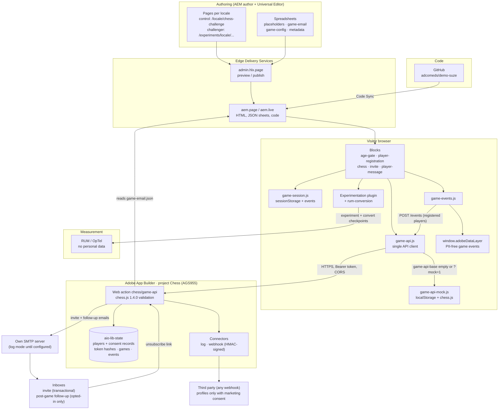

# Suze
Demo site built with Adobe Experience Manager Edge Delivery Services.

## Environments
- Preview: https://main--demo-suze--adcomeds.aem.page/
- Live: https://main--demo-suze--adcomeds.aem.live/

## Documentation

Before using the aem-boilerplate, we recommend you to go through the documentation on [www.aem.live](https://www.aem.live/docs/), more specifically:
1. [AEM Authoring](https://www.aem.live/docs/aem-authoring)
2. [Universal Editor Tutorial](https://www.aem.live/developer/ue-tutorial)
3. [Component Model Definitions](https://www.aem.live/developer/component-model-definitions)
4. [Authoring Path Mapping](https://www.aem.live/developer/authoring-path-mapping)

## Prerequisites

- nodejs 20 or newer
- AEM Cloud Service release 2026.4 or newer

## Installation

```sh
npm i
```

## Linting

```sh
npm run lint
```

## Suze Chess Challenge

A gamified, multilingual chess experience: age gate, player registration, a turn-based chess
board and a friend invite, A/B tested with the AEM Experimentation plugin. Front end and content
only. The backend (App Builder) is built separately against
[`docs/game-api-contract.md`](docs/game-api-contract.md).

### Locales and MSM

- **Game markets:** `us/en`, `us/es` and `fr/fr`.
- **Blueprints:** `masters/<lang>` are the MSM blueprints the markets inherit from. They are not
  published, so the chess page and its sheets are authored in `masters/en` and rolled out to `us/en`.
- **Experiment:** `exp-chess-001` lives in each market.
  - English control: `us/en/chess-challenge` (a live copy). Its experiment page properties are set
    locally, with inheritance cancelled.
  - English challenger: `/experiments/us/en/chess-challenge/exp-chess-001/challenger` (local, not
    MSM managed).
- **Age gate:** `us/en` and `us/es` use date of birth with a minimum of 21. `fr/fr` uses yes/no
  with 18.

### Architecture

The diagrams are in [`docs/architecture.md`](docs/architecture.md): system overview, game flow,
and the A/B experiment and conversion.



### What is where

| Path | Purpose |
|---|---|
| `blocks/age-gate` | Yes/no or date of birth check (block option), legal age per locale page. Only the outcome is kept, in `sessionStorage`. |
| `blocks/player-registration` | First name, email, required game terms checkbox and optional marketing checkbox (both unchecked). Calls `registerPlayer`. |
| `blocks/chess` | Board, rules (chess.js), keyboard play, polling, result screen, challenger option `nudge`. |
| `blocks/player-message` | On-site marketing message for the current visit: one authored item per audience (opted-in, waiting, won, lost, draw), shown only to players who passed the age gate and opted in. `{firstName}` is personalised from the game data. Also shows the unsubscribe confirmation (`?unsubscribed=1`). |
| `blocks/invite` | Friend's email, calls `sendInvite`. The send button is `#chess-invite-send` in `#chess-invite-form`. |
| `scripts/game-api.js` | The only module blocks call: one async function per endpoint. |
| `scripts/game-api-mock.js` | The full contract in the browser (localStorage, chess.js validation, about 300 ms latency). |
| `scripts/game-events.js` | Site event layer: pushes PII-free events to `window.adobeDataLayer` and, for registered players, to `POST /events`. |
| `scripts/game-session.js` | Per-tab session state and the events the blocks use to talk to each other. |
| `scripts/placeholders.js` | Per-locale `placeholders` sheet and site `game-config` sheet readers. |
| `scripts/game-form.js`, `styles/game-form.css` | Shared accessible form helpers for the three forms. |
| `scripts/vendor/chess.js` | chess.js 1.4.0, vendored (see licence below). |
| `plugins/rum-conversion` | [aem-rum-conversion](https://github.com/adobe/aem-rum-conversion) (main at `0e3f4ed`), copied in. Convert it to a `git subtree` when committing if you want `git subtree pull` updates. |
| `docs/game-sheets` | Copy for all sheets (`*.source.json`), paste-ready CSV output and the [AEM hand-off guide](docs/game-sheets/README.md). |
| `tools/importer/import-chess-challenge.js`, `tools/importer/sources/chess-challenge` | Import script and authoring briefs that generate the six pages. |

All user-facing strings come from the per-locale `placeholders` sheet (`/<locale>/placeholders.json`).
A missing key renders as the key itself, so gaps are easy to spot. There is no fallback copy in JavaScript.

### Local development

```sh
npm run sheets:local   # local-only copies of the sheets (gitignored, never commit them)
aem up --html-folder content
```

Then open `http://localhost:3000/content/us/es/chess-challenge` (or `fr/fr`, the `masters/en` blueprint, and the
challengers under `/content/experiments/<locale>/chess-challenge/exp-chess-001/challenger`). The local
dev server mounts imported pages under `/content`. The locale helpers in `scripts/scripts.js` know about
this mount on `localhost`.

Page metadata does become `<meta>` tags locally, so the experiment plugin runs, but the challenger
URLs (`/experiments/...`) are only served once published. Check the experiment itself (overlay,
`?experiment=`) on `*.aem.page`.

To regenerate the pages after changing a source brief, bundle and run the import script with the
standard bulk importer and `tools/importer/urls-chess-challenge.txt`. Each source is imported twice:
once as is (control) and once with `?variant=challenger`.

**After every import, run `npm run export:clean`.** The import rebuilds the AEM export
(`migration-work/jcr-content`) from every file in `content/`, including July migration leftovers: an empty
`masters` page, empty `fr/fr` and `fr/en` parents, and France/English snapshots. Pushed to AEM, those
wipe the blueprints and break MSM live copies. The script keeps only the chess pages and moves the rest to
`migration-work/jcr-content-quarantine/`.

### Consumer data capture and marketing messaging

AEM and App Builder only. No Adobe Experience Platform, Journey Optimizer or tracking SDK. The
data can still be passed to a third party through the backend connectors. Contract additions:
`docs/game-api-contract.md` (v1.1). Backend brief: `docs/backend-marketing-prompt.md`.

- **Data capture:** the registration form sends first name, email, locale, both consents and a
  `context` (page, experiment, variant). The backend keeps a consent record with timestamps.
  Only the marketing opt-in flag (a boolean) is kept in the browser session.
- **Events:** `scripts/game-events.js` pushes
  `{ event: "chess:<type>", eventInfo }` to `window.adobeDataLayer`.
  - Types: `age-gate-passed`, `registered`, `game-created`, `game-joined`, `first-move`,
    `invite-sent`, `opponent-joined`, `game-finished`, `message-shown`, `message-clicked`.
  - For registered players, each event is also sent to `POST /events` (fire-and-forget).
  - `eventInfo` carries only the gameId, outcome or result, audience, opt-in flag, locale, page
    and experiment variant. It never carries names or emails.
  - Type `adobeDataLayer` in the browser console during the demo to show the events.
- **Third parties:** backend connectors (`log`, `webhook` with an HMAC signature). The full
  profile is forwarded only with marketing consent.
- **Post-game follow-up email:** sent by the backend through the own SMTP server, to opted-in
  players only, with a rematch link and an unsubscribe link. The copy is in the `game-email`
  sheets (`followup-win-*`, `followup-loss-*`, `followup-draw-*`).
- **On-site message:** the `player-message` block, authored per locale page (control and
  challenger), for the current visit only.
- **Single opt-in for the demo.** Double opt-in (required in fr/fr), data export and erasure
  requests are production work.

### In the Universal Editor

- **Text:** the page runs on the AEM author host, so the sheets (placeholders, `game-config`) are
  read through AEM's delivery servlet (`/bin/franklin.delivery/adcomeds/demo-suze/main/...`) with
  the author's login. Otherwise the blocks would show raw placeholder keys.
- **Experiment:** it is pinned to `control` (`?experiment=exp-chess-001/control` is added to the
  editor frame's URL), unless a variant is chosen explicitly. A variant swap replaces `<main>` with
  HTML that has no editing markup, which empties the content tree. To edit the challenger, open
  its own page under `/experiments/...`.
- **Playing:** the game API's CORS allow-list doesn't include the author host, so playing the game
  inside the editor stops at registration. Test the game on `*.aem.page` or `*.aem.live`.

### Mock mode and the two-tab demo

The mock is used when `game-api-base` in `/game-config` is empty, or when the URL has `?mock=1`
(remembered for the tab, `?mock=0` switches it off).

1. Tab 1: open the control page, pass the age gate, register, make the opening move.
2. Send an invite to any address. No email is sent. A panel shows the game link instead.
3. Click **Open in a new tab** (`rel="noopener"`, so the new tab is a separate player), pass the
   age gate, register again, and you play black.
4. Moves sync instantly through the `storage` event. The 3 second polling is the fallback, and it
   pauses while a tab is hidden.

In mock mode the invite link points at the page the host is on, so it also works locally and
on unpublished paths. The real backend returns `/<locale>/chess-challenge?game=<id>`.

### Switching to the real API

Set `game-api-base` in the `/content/suze/game-config` sheet to the App Builder base URL and
publish. No code change. The backend must allow CORS from the site origins (see the contract).

The App Builder project (Chess, org AGS955) has Stage and Production workspaces. The Stage URL is
`https://129433-chess-stage.adobeioruntime.net/api/v1/web/chess/game-api`.

After every successful invite, the invite block shows the game link with copy and open buttons,
whether the site uses the real API or the mock. With the real API the panel is headed by the
`invite-sent` string. So the demo works even when the backend's email is in `log` mode, and the
host can always share the link directly. `?mock=1` still forces the in-browser mock as a fallback.

### chess.js

[chess.js](https://github.com/jhlywa/chess.js) **1.4.0**, copyright (c) 2025 Jeff Hlywa,
**BSD-2-Clause** licence (header kept in `scripts/vendor/chess.js`). It handles rules and
validation only, and the board UI is our own DOM/SVG. It is loaded with a dynamic `import()` once a
visitor has registered, so it is never part of the eager phase. To upgrade, replace the file with the
new `dist/esm/chess.js` and tell the backend team: client, mock and backend must run the same
version. The piece artwork in `blocks/chess/pieces.svg` was drawn for this project.

### Experiment `exp-chess-001`

- **Plugin:** the AEM Experimentation plugin already on the site (`plugins/experimentation`, v1.2.0).
- **Control:** `/<locale>/chess-challenge`. **Challenger:**
  `/experiments/<locale>/chess-challenge/exp-chess-001/challenger`. It is identical except for the Chess
  block option *Show an "Invite a friend" prompt after the opening move* (class `nudge`). With it,
  the invite form stays hidden until the host's opening move, then a prompt appears.
- **Page properties on each control page:** `experiment` = `exp-chess-001`, `experiment-variants` =
  the challenger path, `experiment-split` = `50`, `experiment-status` = `Active`.
- **Conversion:** the experimentation docs defer to the
  [aem-rum-conversion](https://github.com/adobe/aem-rum-conversion) plugin. Its documented keys are
  `Conversion Element` (`Link`, `Form` or `Labeled Link`; a CSS selector is not supported) and
  `Conversion Name`. The setup is:
  - `conversion-element` = `Form` on the control page
  - section property **Conversion Name** = `chess-invite` on the invite section
  - A conversion is the submit of `#chess-invite-form`, which is what `#chess-invite-send` triggers.
  - `scripts/scripts.js` loads the plugin lazily and only on pages with a Conversion Element, and limits
    it to sections with a Conversion Name, so the age gate and registration forms never count.
  - Its README says it needs `sampleRUM.convert`, but the code falls back to
    `sampleRUM('convert', ...)`, which the current `aem.js` supports.
  - Never set `Conversion Value Field` on these sections, because it would send a form value (an email) to RUM.
- **Mobile-only audience (optional):** set `experiment-audience` to `mobile` (the `mobile` audience is
  defined in `scripts/scripts.js`). Leave it empty for everyone.
- **Indexing:** the bulk `metadata` sheet sets `robots: noindex,nofollow` on `/experiments/**`.

### Move history panel (left for the live demo)

`blocks/chess/chess.js` renders an empty, hidden `<aside class="chess-history" data-hook="move-history">`
and calls `renderMoveHistory(historyEl, chess.history({ verbose: true }))` after every board update.
The function is a documented no-op marked `TODO(live-demo)`. The label key `chess-history-label`
is already in the sheets.

### Privacy

- No AEM Forms, no analytics or tracking beyond RUM.
- Email addresses and names never go into URLs, storage, the console or RUM. sessionStorage holds
  `playerId`, `token`, `gameId` and the age gate outcome. The mock never stores the invitee's
  email.
- The invite email copy (`game-email` sheets) is transactional only and ends with a responsible drinking line.

### Site-wide fixes made with this work

- `styles/styles.css`: the header reserves no height on first paint. It is an overlay, and the
  lazily loaded header styles set its height to 0, so the 80px placeholder used to make every page
  jump up by about 0.1 CLS on mobile.
- `labelIconLinks()` in `scripts/scripts.js`, used by the header and footer: icon-only links such as
  the logo get an accessible name from the authored link title, or else from the icon name.
- Footer links are at least 24px tall (tap-target size).
- `styles/styles.css`: size-matched fallback fonts for Obviously (Arial/Liberation/Arimo, Roboto and
  DejaVu faces with measured `size-adjust`), so text wraps the same before and after the web font
  loads. On mobile `fonts.css` is lazy, and the swap used to re-wrap the intro text.

Lighthouse on the local dev server, mobile, control page: performance 99, accessibility 100.
Best practices loses points only for the 404 of the not-yet-published challenger, and SEO only for
the local server's no-index header. Re-check on `*.aem.page` after publishing. The Suze Story page
still shows layout shift from its own timeline block (unrelated to this work).
