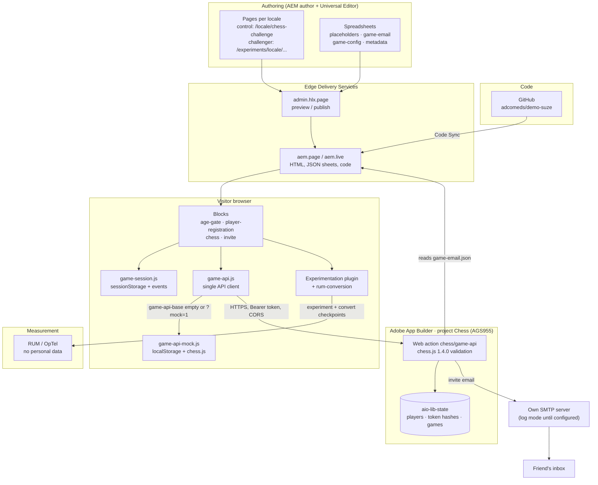
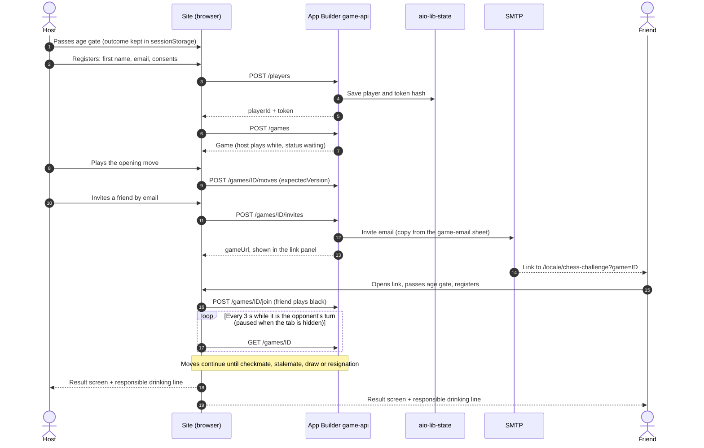
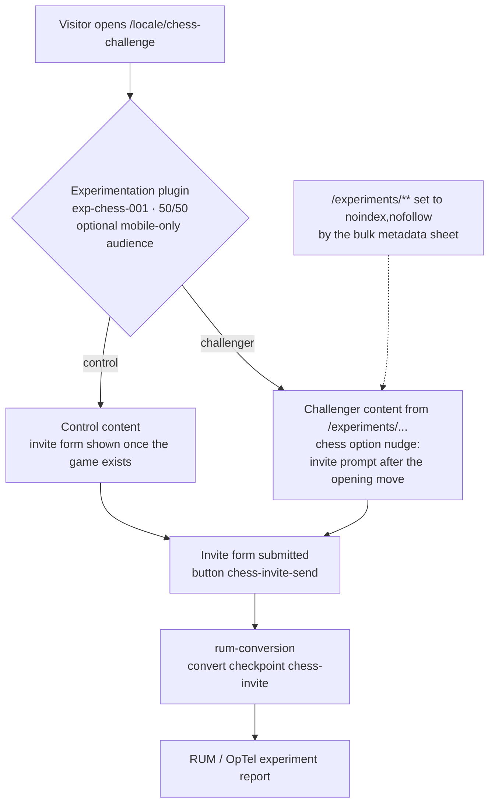

# Suze Chess Challenge architecture

How the chess challenge is put together: authoring in AEM, delivery through Edge Delivery
Services, the game in the visitor's browser, and the App Builder backend. GitHub renders these
Mermaid diagrams directly.

See also:
- [`docs/game-api-contract.md`](game-api-contract.md): the API contract
- [`docs/game-sheets/README.md`](game-sheets/README.md): the AEM hand-off guide
- [`docs/backend-app-builder-prompt.md`](backend-app-builder-prompt.md): the backend brief

## 1. System overview

## 2. Game flow (host and invited friend)

The App Builder backend is shown. The in-browser mock behaves the same way, with `localStorage`
in place of `aio-lib-state` and no email.

## 3. A/B experiment and conversion

## Legend

- **Mock vs real API:** with `game-api-base` empty, or `?mock=1` in the URL, everything runs in the browser and two tabs can play each other. Otherwise the site calls App Builder. That's currently Stage: `https://129433-chess-stage.adobeioruntime.net/api/v1/web/chess/game-api`.
- **Personal data:** the browser stores only `playerId`, the token, `gameId` and the age gate outcome, in `sessionStorage`. Names and emails never go into URLs, logs or RUM.
- **Copy:** editorial text is in the blocks, interface text is in the per-locale `placeholders` sheets, and the email copy is in the `game-email` sheets.
